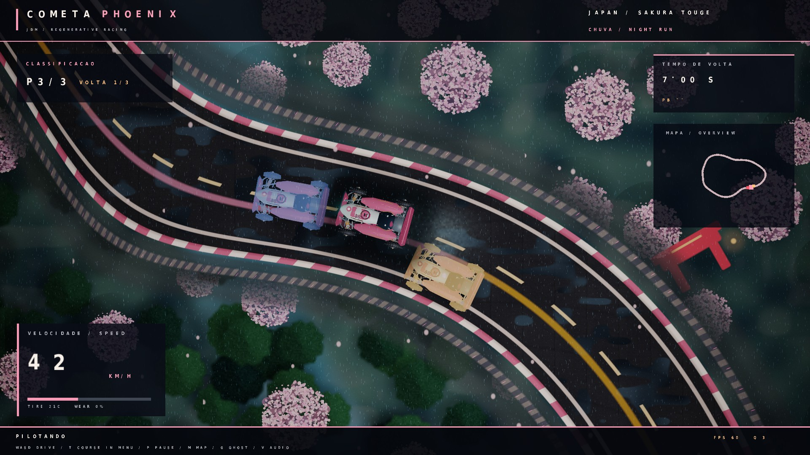

# Cometa Phoenix — Projeto Cometa Livre

**ECOP13A — Programação Orientada a Objetos | LAB12–LAB14 | UNIFEI | 2026.2**



## 1. Direção escolhida e melhorias

O Cometa Phoenix evolui o Kart Cometa para um simulador de corrida e manutenção em C++17. A proposta combina monitoramento de componentes, diagnóstico de danos e reparos com recursos limitados. A versão gráfica acrescenta pistas, clima, adversários e um campeonato de quatro etapas.

A lógica da simulação foi separada da interface: `include/cometa/Simulation.hpp` declara as classes, `src/Simulation.cpp` implementa o motor, `src/main.cpp` oferece a execução no terminal e `game/` contém a interface gráfica e a física de corrida. As estratégias de reparo derivam de `EstrategiaReparo`, utilizando polimorfismo para representar diferentes métodos de manutenção. Essa organização permite testar o motor sem depender da interface gráfica.

O modelo físico é didático, não calibrado para representar um veículo real.

## 2. Templates e STL

- **Templates (LAB12 e LAB13):** em `include/cometa/Simulation.hpp`, a classe `Historico<T>` armazena registros de dois tipos: `EventoDano` e `AmostraTelemetria`. Ambos usam a mesma implementação de registro, consulta e tamanho, evitando duplicação. A função `limitar<T>` restringe valores a um intervalo e é testada com `int` e `double`.
- **STL (LAB14):** `std::vector` armazena componentes e históricos. Em `src/Simulation.cpp`, `std::sort` ordena o ranking de risco, `std::find_if` localiza componentes e `std::all_of` verifica se todos atendem aos limites de segurança. `std::max_element` identifica o componente mais crítico. Os algoritmos operam sobre intervalos definidos por iteradores.

## 3. Compilação, execução e verificação

É necessário um compilador C++17 e CMake 3.16 ou superior.

### Motor no terminal (sem dependências gráficas)

```sh
cmake -S . -B build -DCOMETA_GAME=OFF -DCMAKE_BUILD_TYPE=Release
cmake --build build --config Release
ctest --test-dir build -C Release --output-on-failure
./build/cometa_phoenix --cenario normal --seed 42 --duracao 22
./build/cometa_phoenix --cenario impacto_critico --seed 42 --duracao 38
```

No Windows com Visual Studio, o executável fica em `build/Release/cometa_phoenix.exe`; execute os mesmos argumentos. 

- **Caso normal:** após 22 s, o kart permanece em corrida, sem eventos de dano.
- **Caso-limite:** no cenário de impacto crítico, o kart abandona a corrida por dano estrutural não autocurável.
- **Verificação adicional:** os testes em `tests/test_sim.cpp` conferem esses resultados, o uso de templates, a ordenação por risco, reparos, recursos insuficientes e entradas inválidas.

### Interface gráfica

No Linux (Debian/Ubuntu), instale `build-essential`, `cmake` e `libsdl2-dev`. É necessário suporte a OpenGL 3.3.

```sh
cmake -S . -B build-game -DCMAKE_BUILD_TYPE=Release
cmake --build build-game --parallel 4
./build-game/cometa_game
```

No Windows, consulte [as instruções de compilação com Visual Studio e vcpkg](game/docs/WINDOWS.md).

Na demonstração gráfica, Enter inicia a corrida, WASD/setas dirigem, X provoca dano de teste e Z provoca dano crítico. J, no menu, inicia o campeonato.

## 4. Fontes e ferramentas

- Enunciado Projeto Cometa Livre (LAB12–LAB14), UNIFEI, e código dos laboratórios anteriores em `referencias/`.
- Documentação de [C++ e STL](https://en.cppreference.com/), [CMake](https://cmake.org/documentation/), [SDL2](https://wiki.libsdl.org/SDL2/FrontPage) e [OpenGL](https://www.khronos.org/opengl/).
- ChatGPT e Codex: assistência na implementação, investigação de erros, revisão, testes e documentação. Higgsfield: apoio à referência artística.
- Referências sobre materiais autorreparáveis e créditos dos recursos gráficos: [referências](docs/REFERENCIAS.md) e [créditos](docs/ASSETS_CC0.md).

Documentação complementar: [arquitetura](docs/ARQUITETURA.md), [testes](docs/TESTES.md) e [histórico de versões](docs/CHANGELOG.md).
